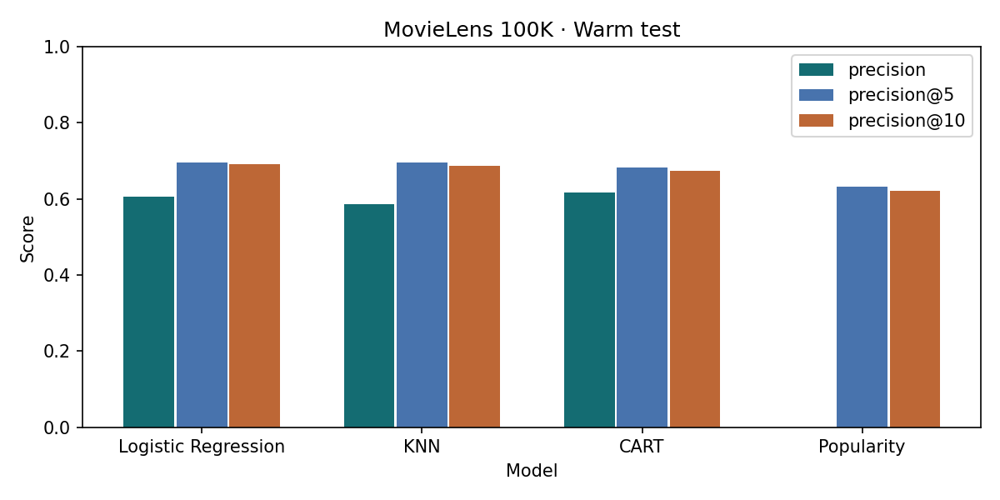

# Báo cáo thực nghiệm MovieLens 100K

## Thiết lập

Bộ dữ liệu có 100.000 lượt chấm trên 1.682 phim từ 943 người dùng. Tỷ lệ lượt chấm từ 4 sao trở lên là 55,38%. Với seed 42, quá trình chia tập tạo 56.223 lượt train và 13.221 lượt validation. Tập test có 2.333 lượt của người dùng có lịch sử và 12.667 lượt cold-start. Trong số lượt cold-start, 2.624 đến từ các ID giữ riêng và 10.043 đến từ những người lần đầu xuất hiện trong giai đoạn test.

Các mô hình dùng cùng đặc trưng và cách chia. Theo Precision@5 trên validation, Logistic Regression đạt 0,726, KNN đạt 0,701 và CART đạt 0,722. Logistic Regression với `C=1` được chọn cho app. Ngưỡng phân loại của mô hình là 0,30, chọn theo F1 trên validation. Top-K được xếp theo xác suất, độc lập với ngưỡng.

## Kết quả trên người dùng có lịch sử

| Mô hình | Accuracy | Precision | Recall | F1 | Precision@5 | Precision@10 |
|---|---:|---:|---:|---:|---:|---:|
| Logistic Regression L2 | 0,649 | 0,607 | 0,932 | 0,735 | 0,695 | 0,691 |
| KNN | 0,622 | 0,585 | 0,950 | 0,724 | 0,695 | 0,688 |
| CART | 0,638 | 0,617 | 0,807 | 0,700 | 0,682 | 0,673 |
| Baseline độ phổ biến | — | — | — | — | 0,632 | 0,621 |

Precision@5 tính trên 44 người và Precision@10 trên 33 người. Logistic Regression đạt Precision@5 cao hơn baseline khoảng 6,4 điểm phần trăm và ngang KNN trên test. CART có Precision phân loại cao nhất trong nhóm này, với Recall thấp hơn Logistic Regression.

Ma trận nhầm lẫn của Logistic Regression với thứ tự nhãn 0 rồi 1:

| | Dự đoán 0 | Dự đoán 1 |
|---|---:|---:|
| Thực tế 0 | 379 | 736 |
| Thực tế 1 | 83 | 1.135 |

## Cold-start và phân tích lỗi

Trên nhóm cold-start, Logistic Regression đạt Precision 0,636, Recall 0,877, F1 0,737 và Precision@5 0,777. Baseline đạt Precision@5 0,655. Precision@5 tính trên 145 người và Precision@10 trên 141 người. Thành phần người dùng và tập phim đã chấm khác giữa hai nhóm, nên mức chênh lệch này chưa đo riêng tác động của việc thiếu lịch sử.

Khi bỏ lịch sử cá nhân trên chính 2.333 lượt warm test và giữ nguyên mô hình, thông tin phim và nhân khẩu học, Precision@5 tăng nhẹ từ 0,695 lên 0,700, còn Precision@10 giảm từ 0,691 xuống 0,676 và Recall giảm từ 0,932 xuống 0,887. Kết quả cho thấy tác động của lịch sử cá nhân phụ thuộc vào chỉ số trong lần chạy này.

| Nhóm phim theo lượt chấm trước test | Lượt test | Tỷ lệ dương tính giả | Tỷ lệ âm tính giả |
|---|---:|---:|---:|
| Chưa có lượt chấm | 76 | 27,5% | 55,6% |
| Ít lượt chấm, từ 1 đến 5 | 72 | 27,1% | 54,2% |
| Trung bình, từ 6 đến 57 | 763 | 57,4% | 11,1% |
| Phổ biến, trên 57 | 1.422 | 79,6% | 2,1% |

Một lượt chấm 2 sao cho *It's a Wonderful Life* được mô hình dự đoán xác suất thích 0,870. Phim có 161 lượt chấm trước test. Ngược lại, một lượt 5 sao cho *Les Boys* được dự đoán 0,026 khi phim chỉ có một lượt chấm trước test. Tỷ lệ dương tính giả của nhóm phim phổ biến phù hợp với dấu hiệu thiên lệch về phim được chấm nhiều. Hai nhóm ít dữ liệu có ít lượt test, nên tỷ lệ của chúng nhạy với từng trường hợp.

Điểm trung bình của phim và của người dùng là hai đặc trưng có hệ số dương lớn nhất theo trị tuyệt đối trong Logistic Regression. Hệ số mô tả liên hệ trong mô hình sau tiền xử lý. Chạy `python -m src.train` để xem hệ số, các luật đầu của cây CART và toàn bộ kết quả trong `reports/generated/metrics.json`.

## Phạm vi đánh giá

Precision@K ngoại tuyến chỉ xếp hạng các phim có lượt chấm trong tập test. Ứng dụng thực tế xếp hạng danh mục phim chưa được hồ sơ chấm tại thời điểm chụp lịch sử. Kết quả trên MovieLens 100K phản ánh hành vi trong bộ dữ liệu năm 1997–1998. Ghép theo tiêu đề chuẩn hóa và năm phát hành cho phép dùng TMDB để hiển thị thông tin bổ sung cho 442 trong số 1.682 phim. Tỷ lệ ghép này phụ thuộc vào độ trùng lặp của hai danh mục và quy tắc ghép.
